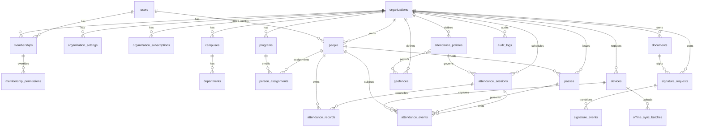

# Prism Pass — Data Model & ERD (Phase 0)

## 1. User vs Person (critical)

- `users`: global authenticated identity (Supabase Auth → internal `users.id`). One human = one `users` row. Can hold **many memberships**.
- `people`: attendance subject owned by **one organization**. Student/intern/employee/visitor. May have `userId` link or be login-less.
- Never require a login to register attendance. Never duplicate `users` per org.

## 2. Mermaid ERD

## 3. Table responsibilities

| Table | Org-scoped | Notes |
|---|---|---|
| `users` | no (global) | `id, authId unique, email, createdAt` |
| `organizations` | self | `id, slug unique, name, status: active|suspended|pending_deletion, timezone` |
| `memberships` | `organizationId` | `userId, organizationId, role, status: active|revoked, revokedAt`; unique `(organizationId, userId)` |
| `membership_permissions` | via membership | `membershipId, permission, allow: boolean`; unique `(membershipId, permission)` |
| `organization_settings` | `organizationId` | branding, policies refs, retention |
| `organization_subscriptions` | `organizationId` | plan, entitlements JSON, metering cursor |
| `campuses` | `organizationId` | `name, timezone, address`; unique `(organizationId, slug)` |
| `departments` | `organizationId` | optional `campusId` (same org enforced) |
| `programs` | `organizationId` | OJT/class/workforce program |
| `people` | `organizationId` | `displayName, userId? nullable, externalId?, status`; unique `(organizationId, externalId)` where not null |
| `person_assignments` | `organizationId` | person → program/class/event unit + role + window |
| `passes` | `organizationId` | `passPublicId, personId, version, status: active|revoked|expired, credentialHash, expiresAt`; unique `(organizationId, passPublicId)`, unique `(organizationId, credentialHash)` |
| `attendance_policies` | `organizationId` | grace, late threshold, duplicate window, geo mode, evidence required, approval steps, timezone |
| `attendance_sessions` | `organizationId` | `policyId, type: event|ojt|shift|class|visitor|training, startsAt, endsAt, geofenceIds[]` |
| `attendance_events` | `organizationId` | append-only; `id UUID, idempotencyKey unique per org, sessionId, personId, passId+passVersion, type, clientTs, serverTs, geo {lat,lng,accuracy}, geofenceResult, deviceId, networkState, source, payloadHash, prevHash?, status` |
| `attendance_records` | `organizationId` | reconciled: `sessionId, personId, checkInEventId, checkOutEventId, durationMin, status, approvalStatus, exceptionFlags[]`; unique `(organizationId, sessionId, personId)` with exception path |
| `geofences` | `organizationId` | `campusId?, centerLat, centerLng, radiusM, label`; circular v1 |
| `documents` | `organizationId` | `template, version, sha256, storageRef (private bucket), status: draft|sealed|superseded|revoked` |
| `signature_requests` | `organizationId` | `documentId, order JSON, policy, status, expiresAt` |
| `signature_events` | `organizationId` | append-only; signer, docVersion, hash, method, consentVersion, serverTs, authEvidence, device, prevHash/currHash |
| `devices` | `organizationId` | scanner identity, `devicePublicId, role, lastSeen, keyRef`; unique `(organizationId, devicePublicId)` |
| `offline_sync_batches` | `organizationId` | `deviceId, batchId, receivedAt, accepted/rejected counts, error JSON` |
| `audit_logs` | `organizationId nullable*` | `actorId?, orgId?, action, resource, result, ip/device, at`; *platform actions have null org + platform actor; immutable, no updates/deletes |

## 4. Integrity rules (enforce from migration 1)

- Every tenant table has non-null `organizationId`.
- Composite FKs: e.g. `(organizationId, sessionId)`, `(organizationId, personId)`, `(organizationId, passId)` — never join across orgs.
- `attendance_events.idempotencyKey` unique per `(organizationId, idempotencyKey)`; stable UUID generated at capture.
- No check-out before check-in without explicit `MANUAL_EXCEPTION` + reason + audit.
- Event timestamps immutable; corrections = new events.
- Timezone: store UTC; render in `organizations.timezone` / session historical timezone.
- `passes.credentialHash` — QR payload is opaque reference, never PII.
- Private files in Supabase Storage; DB holds `storageRef + sha256` only.

## 5. Prisma draft
See `prisma-draft.prisma` in this folder for the normative field list. Migrations + RLS are Phase 1.
