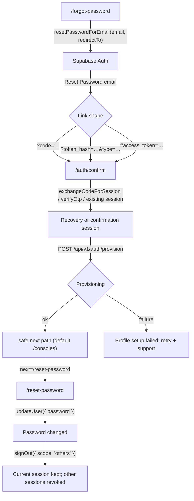

# Password reset and email confirmation

Scope: the public recovery flow built on Supabase Auth and `@supabase/ssr`.

| Route | File | Purpose |
| --- | --- | --- |
| `/forgot-password` | `app/(auth)/forgot-password/page.tsx` | Request a reset email without revealing whether an account exists. |
| `/auth/confirm` | `app/auth/confirm/page.tsx` | Shared email-link callback for recovery, signup, invite, magic link and email confirmation. Establishes the session and provisions the profile. |
| `/reset-password` | `app/(auth)/reset-password/page.tsx` | Requires the session created by the link, then sets a new password. |

The login page's "Reset it" link is expected to point at `/forgot-password`. The signup
page is expected to pass
`emailRedirectTo: \`${window.location.origin}/auth/confirm?next=/consoles\`` so confirmation
emails use the same callback. Both are owned by other files and are not edited here.

## Happy path



Recovery requests set
`redirectTo = ${window.location.origin}/auth/confirm?next=/reset-password`. The `next`
parameter is what sends a recovery link on to the password form after the callback has
established a session. Signup confirmation uses the same callback with
`next=/consoles`.

## Token and URL handling

The callback accepts four entry shapes:

1. **PKCE code** — `?code=…`. Exchanged with `supabase.auth.exchangeCodeForSession(code)`.
   The code is single-use and is bound to the code verifier stored by the browser that
   requested the email. It is accepted only in that browser profile.
2. **Token hash** — `?token_hash=…&type=…`. Verified with
   `supabase.auth.verifyOtp({ type, token_hash })`. The page accepts only `recovery`,
   `signup`, `email`, `invite` and `magiclink`; any other type is treated as an invalid
   link.
3. **Implicit fragment** — `#access_token=…`. The browser client detects it during
   initialisation. If no query parameters are present, the page calls `getSession()` and
   continues only when a session exists; otherwise it shows the invalid-link state.
4. **Provider error** — `?error=…&error_description=…`. Shown as a friendly error with
   links to request a new link or sign in.

Handling rules:

- The page captures `code`, `token_hash`, `error` and `error_description` once, then
  removes them from the address bar with `history.replaceState` before doing any network
  work. A copied URL, screenshot or browser-history entry therefore does not contain a
  usable one-time credential.
- Tokens are never written to application storage, logs, analytics or error reports.
  `token_hash` and `code` exist only in local variables for the duration of the exchange.
- The `next` value is frozen before the URL is scrubbed so a provisioning retry cannot
  silently change the destination.
- The callback renders through a `Suspense` boundary because it reads
  `useSearchParams()`.
- Passwords are never logged. Supabase error messages shown in the UI do not include
  credentials.

## No account enumeration

`/forgot-password` does not ask Supabase whether the address exists and does not branch on
the result. Every accepted submission — existing account, unknown address, or a failed
request — renders the same message:

> If an account exists, a reset link has been sent.

Consequences:

- A visitor cannot use this page to discover which email addresses are registered.
- Server-side timing differences and Supabase's own rate-limit responses remain outside
  the page's control (see residual risks).
- A delivery outage or SMTP misconfiguration also appears as the generic success state.
  This is the deliberate trade-off of no-enumeration; administrators diagnose delivery
  from Supabase Auth logs, not from the page.
- The client-side 30-second resend cooldown is a UX guard, not a security control. It is
  trivially bypassed by reloading the page; Supabase's server-side rate limits are the
  actual abuse control.

## Session requirements

- `/reset-password` requires a valid Supabase session. On mount it calls `getUser()`; a
  missing session shows an "expired or invalid link" state with links to
  `/forgot-password` and `/login` rather than a silent redirect.
- The session created by a recovery link is a normal authenticated session. It is not a
  separate "reset-only" credential, so the page relies on the link having been single-use
  and short-lived.
- `updateUser({ password })` changes the current user's password. It requires the
  session; a `401` during submit returns the page to the expired-link state.
- After a successful update the page calls `signOut({ scope: "others" })` on a best-effort
  basis. The current session is deliberately kept so the user can continue to
  `/consoles`. If revocation fails, the success panel says other sessions may still be
  active instead of claiming they were signed out.
- The new password must be at least 8 characters and match the confirmation field. The
  Supabase project's own minimum-length and leaked-password settings still apply; the
  client value is a floor, not the authority.

## Redirect safety

`lib/auth/redirect.ts` is a pure, dependency-free helper used by `/auth/confirm`:

- `safeNextPath(value)` returns a same-origin path or `null`.
- `resolveNext(value, fallback = "/consoles")` returns the safe path, or a validated
  fallback.

A value is accepted only when, after one percent-decoding pass, it:

- starts with exactly one `/` (so `https://evil.com`, `javascript:` and relative values
  are rejected);
- does not start with `//` (protocol-relative);
- contains no backslash (browsers normalise `\` to `/`, so `/\evil.com` would otherwise
  become `//evil.com`);
- contains no control characters (encoded newlines/tabs are rejected);
- decodes successfully (malformed `%` sequences are rejected).

Query strings and fragments are preserved: `/consoles?org=acme#passes` is a same-origin
path. The fallback passed to `resolveNext` is validated too, so an unsafe default cannot
be introduced by accident.

## Supabase dashboard configuration

Project assumptions verified for this build:

- `mailer_autoconfirm=false` — email confirmation is required.
- `disable_signup=false` — self-service signup remains enabled.
- Email confirmation is required before sign-in.

### URL Configuration

Authentication → URL Configuration:

- **Site URL:** `https://pass.syntaxure.dev`
- **Redirect URLs** — add both exact entries:
  - `https://pass.syntaxure.dev/auth/confirm`
  - `http://localhost:3000/auth/confirm`

The app appends `?next=…` to the callback. GoTrue matches the allowlist against the
redirect URL's scheme, host and path, ignoring the query string and fragment, so the
`?next=` parameter does not need its own allowlist entry. If a future proxy changes the
path or host, add that exact origin/path instead of a broad wildcard.

Do not add preview or branch-deployment URLs for this flow: only `main` and `develop`
are deployment-eligible in this repository, and recovery emails should always return to
the canonical host.

### Email templates

Authentication → Email Templates.

**Reset Password** must link to the confirmation callback. The recommended, default-safe
form keeps Supabase's confirmation URL, which verifies the token and then redirects to the
allowlisted `/auth/confirm?next=/reset-password` with a `code` (PKCE) or fragment tokens:

```html
<h2>Reset Password</h2>
<p>Follow this link to reset the password for your user:</p>
<p><a href="{{ .ConfirmationURL }}">Reset Password</a></p>
```

The app supplies `redirectTo` when it calls `resetPasswordForEmail`, so the destination
after verification is the callback, not the bare Site URL. Confirm the template has not
been replaced with a plain `/reset-password` link: that page requires a session and would
show the expired-link state.

For a cross-device-friendly variant, the template can verify the token directly on the
callback instead of routing through Supabase's verify endpoint:

```html
<a href="{{ .SiteURL }}/auth/confirm?token_hash={{ .TokenHash }}&type=recovery&next=/reset-password">
  Reset Password
</a>
```

This form depends on the Site URL being correct for the environment sending the email.
It avoids the PKCE code-verifier binding, so a link opened on a phone after requesting it
on a desktop can work. Pick one form per environment; do not mix both links in one
template.

**Confirm signup** should likewise land on `/auth/confirm`. Either keep
`{{ .ConfirmationURL }}` and have the signup call pass
`emailRedirectTo: ${origin}/auth/confirm?next=/consoles`, or use:

```html
<a href="{{ .SiteURL }}/auth/confirm?token_hash={{ .TokenHash }}&type=signup&next=/consoles">
  Confirm your email
</a>
```

### Other Auth settings

- **Email OTP expiration:** keep the default short window (1 hour) or lower it. The
  expired-link state is the expected outcome after it passes.
- **Rate limits:** keep the built-in reset-email limits enabled. The page's cooldown is
  cosmetic; Supabase enforces the real limit.
- **SMTP:** configure custom SMTP before production. The default Supabase SMTP service is
  rate-limited and intended for testing.
- **Minimum password length:** if the project raises it above 8, update the client
  minimum in `app/(auth)/reset-password/page.tsx` so the form does not promise a
  length the server will reject.
- **Leaked password protection:** enabling it adds a server-side check; the page will
  display Supabase's rejection message.

## Local development

- Requesting a reset against the hosted project from `http://localhost:3000` needs the
  localhost callback in the redirect allowlist. The same email template is used for both
  environments.
- A reset email requested locally still uses the hosted project's SMTP and Site URL. If
  the template uses `{{ .SiteURL }}` for a token-hash link, it points at production. Use
  the default `{{ .ConfirmationURL }}` form, or run the Supabase CLI locally, when
  testing on localhost.
- The callback must be opened in the same browser profile as the request when the PKCE
  `code` flow is used.

## Failure states

| Condition | UI |
| --- | --- |
| Unknown email | Same generic success panel as a known email. |
| Reset request fails (network/SMTP) | Same generic success panel; diagnose in Supabase Auth logs. |
| Missing or expired session on `/reset-password` | "This reset link has expired" with new-link and sign-in links. |
| `?error=…` on the callback | Friendly error with the provider description, new-link and sign-in links. |
| Invalid/unsupported `type` | Invalid-link state; no OTP call is made. |
| No parameters and no session | Invalid-link state. |
| Session established, provisioning fails | "Account confirmed, but profile setup failed" with a retry button and support note. The page does not continue silently. |
| Password update rejected | Inline Supabase error. A `401` returns to the expired-link state. |
| Other-session revocation fails | Success is kept, but the copy says other sessions may still be active. |

## Verification

Pure unit tests cover the redirect guard; they do not need a DOM, a network or Supabase.

```text
pnpm exec vitest run tests/auth-recovery.test.ts
Test Files  1 passed (1)
Tests       43 passed (43)
```

`pnpm exec tsc --noEmit` completes with no diagnostics.

The authenticated flows themselves are not exercised against a live Supabase project in
this change. Route wiring is verified by type checking and code inspection; delivery,
SMTP, template rendering and the Supabase redirect allowlist remain dashboard
configuration that must be verified in the target project.

## Residual risks

1. **Email deliverability.** Spam filtering, a missing custom SMTP configuration, or a
   provider outage can stop the email without changing the generic success panel. Users
   learn nothing; administrators must use Supabase Auth logs. The alternative — showing
   delivery errors — would reintroduce an enumeration or configuration oracle.
2. **Link expiry and single use.** Expired or already-opened links show the expired-link
   state. That is correct but adds a support step; shortening the email redirect or
   adding a "request another" button on the login page reduces friction.
3. **Shared devices.** Opening the link signs that browser in. On a shared computer the
   recovery session can persist after the password change; `signOut({ scope: "others" })`
   protects other devices but not the current one. Users should close the browser or sign
   out on shared machines.
4. **Cross-browser PKCE.** With the default `{{ .ConfirmationURL }}` flow, the code
   verifier lives in the browser that requested the email. Opening the link in a different
   browser produces the invalid-link state. The token-hash template variant removes this
   limitation at the cost of depending on a correct Site URL per environment.
5. **No-enumeration vs. timing.** The page's responses are uniform, but Supabase's
   server-side processing time, rate-limit responses and email delivery can still differ.
   Closing those channels is a Supabase platform concern, not an application one.
6. **Client-side cooldown.** The 30-second resend cooldown is bypassable. Supabase rate
   limits are the real control; no application-level reset limiter was added because
   there is no shared store in this deployment.
7. **Provisioning failure.** A confirmed account can exist without a profile if
   `/api/v1/auth/provision` fails and the user abandons the retry. The page surfaces the
   failure; it does not queue a background retry or create the profile itself.
8. **Callback URL scrubbing is best effort.** `history.replaceState` removes one-time
   parameters from the current entry, but credentials may already have reached browser
   history, screenshots or extensions before the script runs. The tokens remain
   short-lived and single-use.
